# 天元 · Origin of the Universe

**A 60-second portrait film made of 40,000 particles that never cuts.**

1080x1920 · 60 fps · 60.000 s · 3600 frames · 100% procedural — no footage, no models, no textures.
Every pixel comes from one WebGL2 point cloud whose target distribution changes over the twelve acts
of the film: deep star shell → ring → nested rings → particle planet → 64 planets → spiral galaxy →
361 galaxies → a 19x19 board → black hole and accretion flow → absolute black → singularity →
rebirth wave → the title, written by the swarm itself.

The repository is two things at once: the finished film, and a **Codex skill** that teaches the
technique that produced it.

## Watch

- **Preview** (1080x1920, 44 MB, web-optimised): [`media/video/tianyuan-origin-preview-1080x1920-60fps.mp4`](media/video/tianyuan-origin-preview-1080x1920-60fps.mp4)
- **Master** (1080x1920, CRF 16, ~211 MB): attached to the release for this repository.

## Keyframes

Full-resolution stills pulled straight from the master are in [`media/keyframes/`](media/keyframes).

| | | | | |
|---|---|---|---|---|
| act I<br>starfield | deep sky | ring | shell | planets |
| 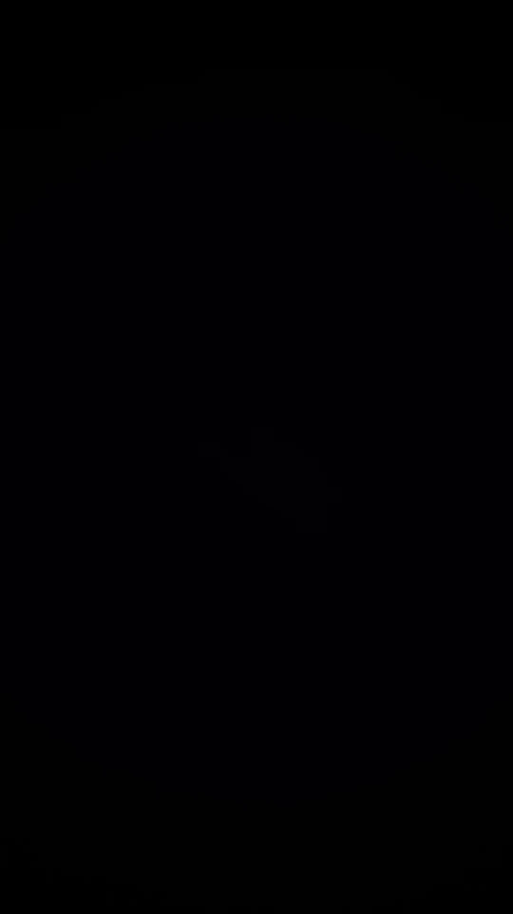 | 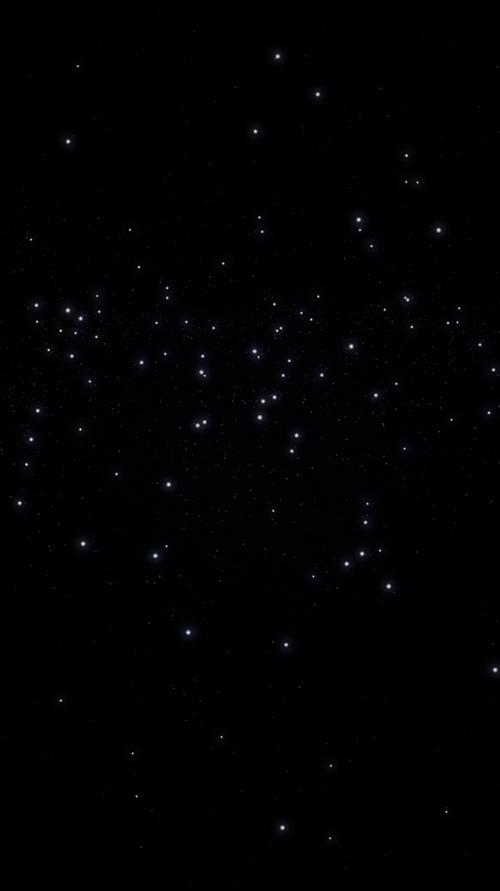 | 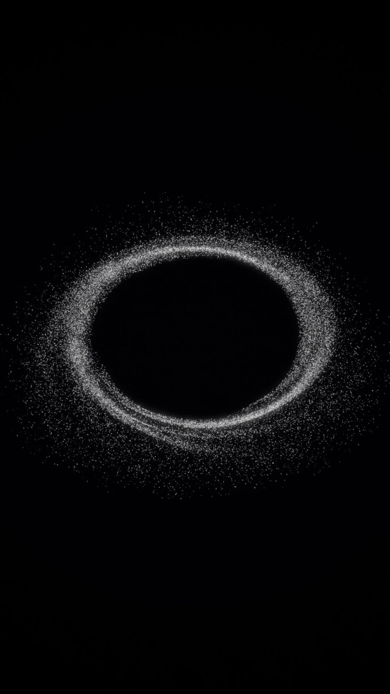 | 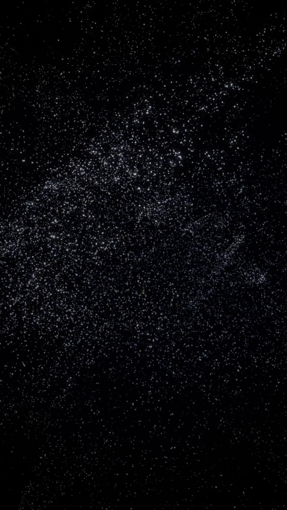 | 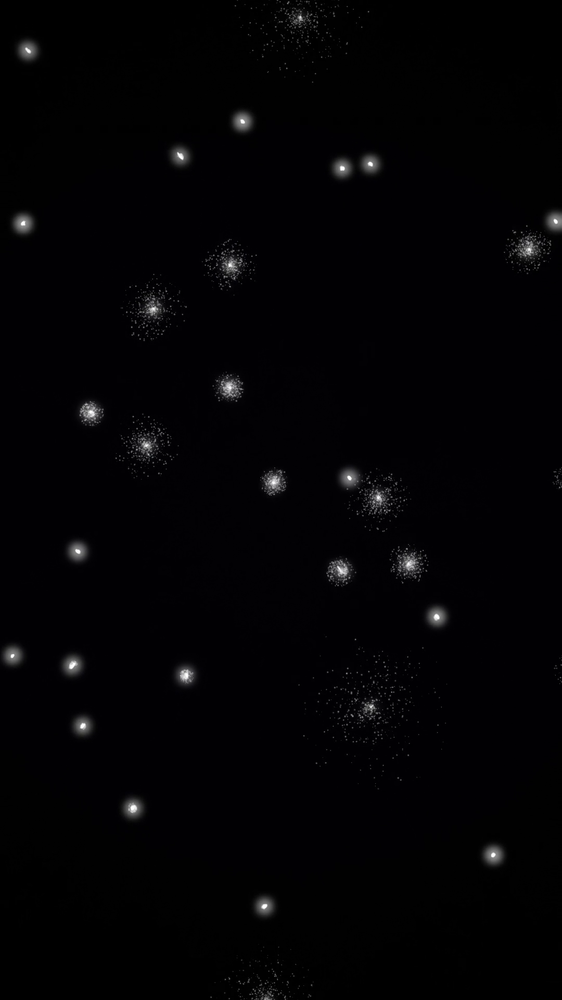 |
| galaxy | board | black hole | rebirth | title |
| 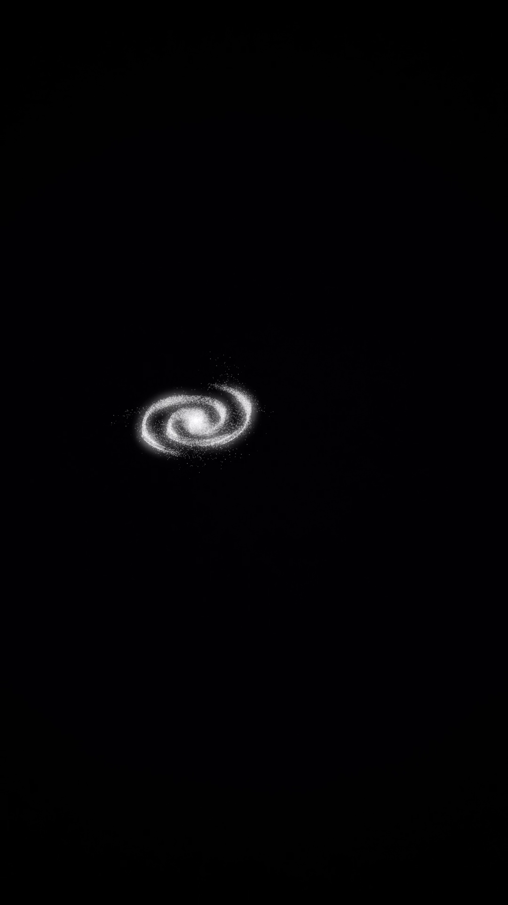 | 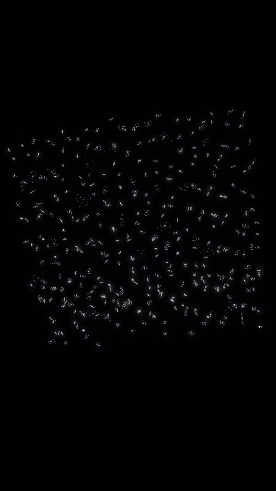 | 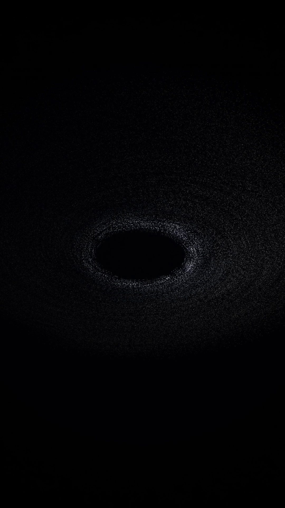 | 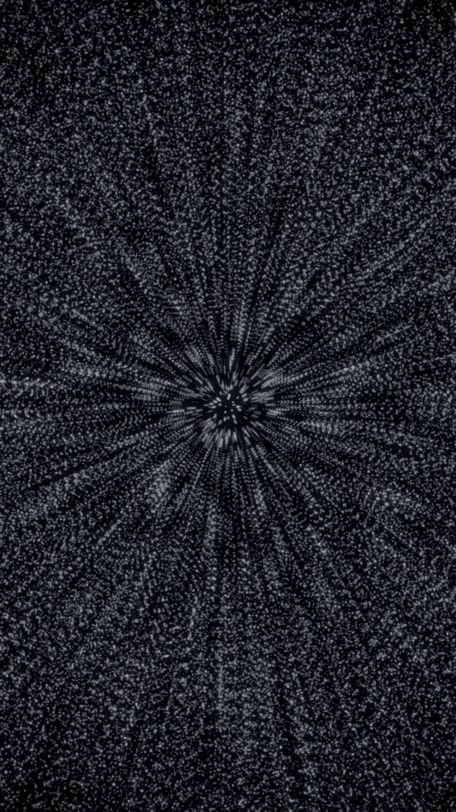 | 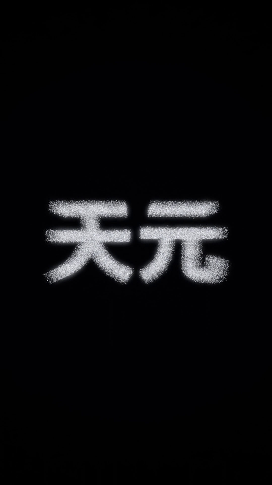 |

Contact sheets over the beats that carry the film:

| 20 beats across the whole film | the rebirth wave, frame by frame | the finale |
|---|---|---|
| [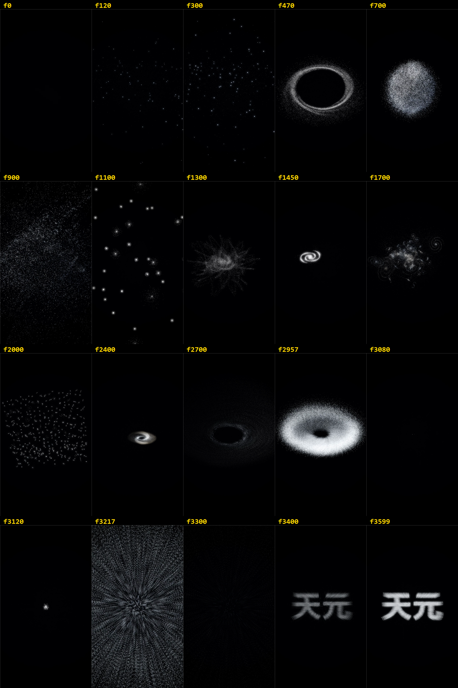](media/contact-sheets/overview-20-beats.png) | [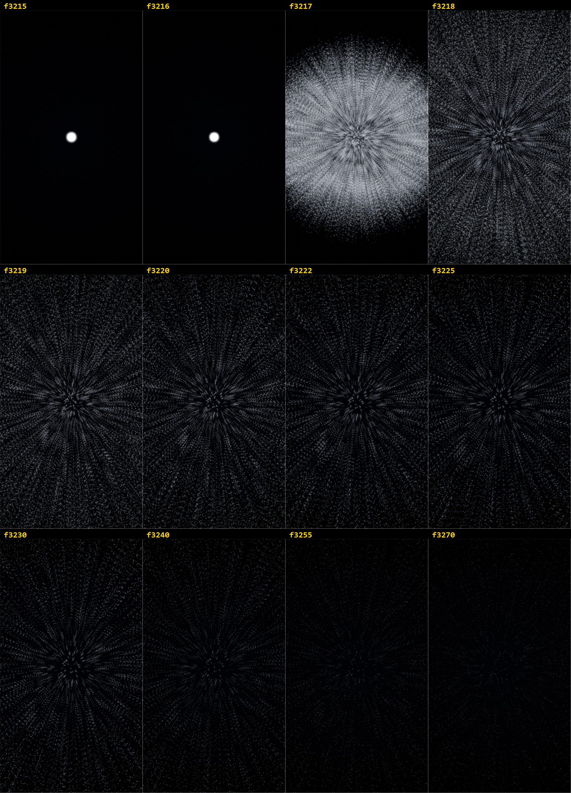](media/contact-sheets/rebirth-wave.png) | [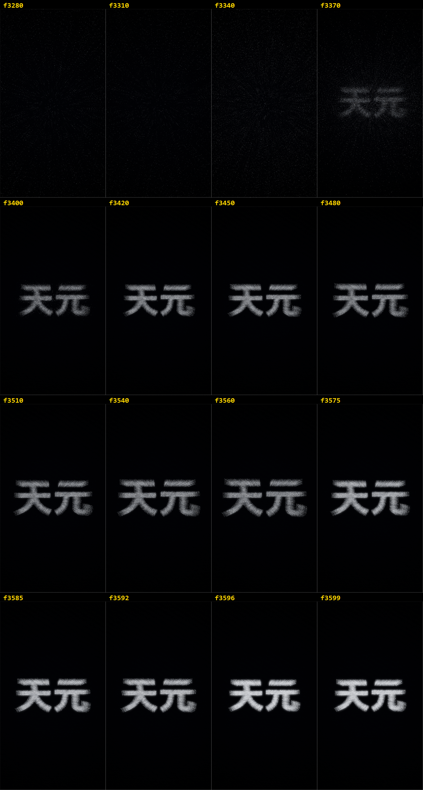](media/contact-sheets/finale-title.png) |

## How it works

Two invariants do most of the work.

**Everything derives from the frame number.** `computeFrameState(t)` in `src/timeline.ts` is the only
source of motion — no wall clock, no `Math.random()` at render time. Per-particle randomness comes
from an integer hash of `(index, channel)`. The same frame therefore always produces the same pixels,
which is what turns the QA pass from a vibe check into a measurement.

**One population, never scenes.** There is no `<Sequence>` and no per-particle DOM node. The whole
film is a single vertex buffer; each act is a target distribution, and structures grow out of each
other because every particle interpolates on its own staggered schedule (`uStagger = 0.42`, offset by
a per-particle birth value).

| pass | target | what it does |
|---|---|---|
| 1 | scene, full res | 40k additive point sprites; `statePos()` returns position *and* velocity |
| 2 | quarter res | bright pass, threshold on the max channel |
| 3 | quarter res | separable 9-tap blur, twice |
| 4 | canvas | bloom mix, soft highlight roll-off, vignette, frame-varying dither |

Motion blur is per-particle, not a post-process: the point pass runs up to four times, each tap
offsetting every particle along the velocity the state function already computed. That is what turns
the accretion disc from concentric rings into flowing matter, and the final plunge into a starburst.

The full technical write-up is in [`references/`](references):
[particle pipeline](references/particle-pipeline.md) ·
[timeline and camera](references/timeline-and-camera.md) ·
[render and QA](references/render-and-qa.md).

## The QA loop

A 1080x1920 / 3600-frame render costs about nine minutes. A quarter-scale pass costs one, so the
cheap loop is: render at `--scale=0.25`, measure every frame, look at a contact sheet, fix, repeat.

`scripts/analyze-frames.ps1` reduces each frame to four numbers —
`luma`, `mean_abs_diff`, `changed_pixels`, `peak_diff` — and `scripts/contact-sheet.ps1` builds the
native-resolution grids. Only once the proxy is signed off does the master get rendered, and then the
finished MP4 is decoded back down and diffed against the approved curve:

```
mean |luma delta| = 0.9287   max |luma delta| = 1.2560 (frame 3217)
brightest frame  reference 3217 / decoded 3217
pearson correlation = 0.999954
```

That last number is the point of the whole loop: it is evidence that the 211 MB file is the cut that
was approved, not merely that the render process exited zero.

## Reproduce it

```bash
cd assets/particle-film-starter
npm i

# the title act needs a CJK-capable bold font - see public/fonts/README.md

# cheap pass: measure and sheet
npx remotion render src/index.ts TianyuanOrigin qa/r01/motion --sequence --scale=0.25 --image-format=png
powershell -File ../../scripts/analyze-frames.ps1 -Dir qa/r01/motion -OutCsv qa/r01/motion.csv

# expensive pass: master, then verify it
npx remotion render src/index.ts TianyuanOrigin output.mp4 --codec=h264 --crf=16 --pixel-format=yuv420p
powershell -File ../../scripts/verify-export-vs-qa.ps1 -Movie output.mp4 -ReferenceCsv qa/r01/motion.csv
```

Retarget `src/config.ts` for resolution, frame rate, particle count, act map and world constants, and
`src/timeline.ts` for the camera, scale, point-size, exposure and bloom tracks.

## Use it as a Codex skill

`SKILL.md`, `references/` and `scripts/` are a [Codex](https://github.com/openai/codex) skill. Clone
this repository into your skills directory and the technique — including the failure modes that are
expensive to rediscover — is available to any future session:

```bash
git clone <this-repo> "${CODEX_HOME:-$HOME/.codex}/skills/remotion-particle-film"
```

Then ask for it directly (`$remotion-particle-film`) or just describe the film you want.

## Repository layout

```
SKILL.md                      the skill: invariants, workflow, load-bearing details
references/                   deep dives - particle pipeline, timeline/camera, render+QA
scripts/                      analyze-frames, contact-sheet, render-proxy, render-master, verify
assets/particle-film-starter/ the exact Remotion project that produced media/
media/keyframes/              10 full-resolution stills from the master
media/contact-sheets/         beat sheets used during QA
media/qa/                     the approved per-frame metrics and the master verification report
media/video/                  web-optimised preview
```

## Output specs

| | preview | master |
|---|---|---|
| resolution | 1080x1920 | 1080x1920 |
| frame rate | 60 fps | 60 fps |
| duration | 60.000 s (3600 frames) | 60.000 s (3600 frames) |
| codec | H.264 High, yuv420p, `+faststart` | H.264 High, yuv420p |
| bitrate | ~6.0 Mbps | ~28.2 Mbps |
| size | 44.6 MB | 211 MB |
| audio | none | none |

The bitrate is high for a mostly-black film and that is deliberate: the composite adds a
frame-varying dither to defeat banding in the dark gradients, which leaves the encoder very little to
coast on. Drop CRF only after you have downscaled.

## License

Code: [MIT](LICENSE).

The film's font is **not** bundled — the title act expects a CJK-capable bold face that you supply
yourself (see [`assets/particle-film-starter/public/fonts/README.md`](assets/particle-film-starter/public/fonts/README.md)).
Noto Sans SC is licensed under the SIL Open Font License 1.1.
